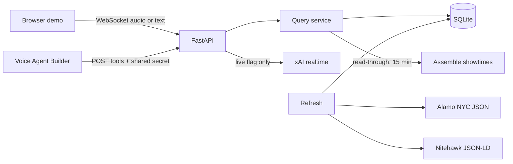

# MovieXFone

A New York City showtimes line. You ask "what's playing near Union Square tonight?" and a short, warm voice answers from a database this service owns. The voice model never looks showtimes up on the web.

MovieXFone is an internal codename. A live trademark (USPTO Reg. 2822672) covers movie schedule and location information services, so this demo does not use that brand, its old catchphrase, or an imitation of that voice.

## Quickstart

```bash
python3 -m venv .venv
source .venv/bin/activate
pip install -e ".[dev]"
python -m moviexfone
```

Open http://127.0.0.1:8000. Type a question, or use the mic where the browser allows it. With no API key the page is a **demo voice**: your browser speaks the `speak` line our server already trimmed. Showtimes still come from the real query layer.

Copy `.env.example` to `.env` if you want overrides. `.env` is gitignored. The only secret is `XAI_API_KEY`, and the repo must never contain one.

Docker:

```bash
docker build -t moviexfone .
docker run --rm -p 8000:8000 moviexfone
```

The image binds `0.0.0.0`. It refuses to start unless `MOVIEXFONE_TOOL_SECRET` is at least 16 bytes. Pass it at run time: `docker run --rm -p 8000:8000 -e MOVIEXFONE_TOOL_SECRET='a-long-random-string' moviexfone`.

## Architecture



The voice agent only talks to this backend. Location resolution, fuzzy titles, borough polygons, distance, and the ten-second answer cap all happen in code. Times are `America/New_York`. A cinema day runs 03:00 to 02:59.

Tools:

| Tool | What it does |
|---|---|
| `search_showtimes` | One call per question. Returns `speak`, at most 2 theaters and 3 times (2 times for "what's playing"). |
| `get_movie_info` | Rating, runtime, one sentence. |
| `end_call` | Short goodbye. |

An empty result includes `nearest_alternative` and tells the model not to search again. An uncovered house (Film Forum, Metrograph, and the other repertory rooms) returns a coverage note instead of invented times.

## Data

Public, keyless sources only.

| Source | How we use it | Terms we follow |
|---|---|---|
| [Assemble](https://docs.assemble.film/showtimes-mcp) | Read-through cache. Serve SQLite, refetch a title when it is older than about 15 minutes. | On-demand, about 60 requests a minute, pass the cinema ticket link through, do not bulk-mirror. |
| [Alamo NYC JSON](https://drafthouse.com/s/mother/v2/schedule/market/nyc) | Loaded on startup when live data is on, and from `POST /admin/refresh`. One call is the whole market. Authoritative for the three Alamo houses. | Undocumented feed. Low volume, identified User-Agent. Not for a public product without asking Alamo. |
| Nitehawk JSON-LD | The two homepages, today only. Those dates replace Assemble for that theater. | Public ScreeningEvent markup. |

There is no AMC developer API, no Fandango, no bot-wall scraping, and no scraper reseller. TMDB is not used. Blurbs in `data/movies.json` are original one-liners so the demo can answer "what's it about?" without a key.

**Fixtures.** This environment could not open `drafthouse.com`, `api.assemble.film`, `nitehawkcinema.com`, or `geosearch.planninglabs.nyc` (TLS was cut by the egress allowlist on 2026-10-13). `data/fixtures/` is synthetic but shaped like those feeds, and one Alamo time and one Nitehawk time are deliberately wrong so tests prove the first-party row wins. They are not a live capture. `python scripts/record_fixtures.py` tries the live hosts and says so if they are blocked.

`MOVIEXFONE_LIVE_DATA=1` loads the theater registry only. It does not load the sample showtimes. Alamo and Nitehawk are fetched at startup. Assemble runs on a background worker that stays under 50 requests a minute and skips a film for 15 minutes after a successful fetch. A cold city lookup can take about 25 seconds, so the voice tool answers from SQLite and never waits on Assemble. `/health/data` shows each source's row count, last fetch, and last error.

Source priority is per theater, not a merge: Alamo feed for Alamo, Nitehawk JSON-LD for the dates it actually publishes, Assemble everywhere else. Assemble rows for an Alamo theater are dropped when the Alamo feed is loaded.

## Voice

Two ways in, one tool layer.

### Browser demo, with a real key

```bash
export XAI_API_KEY='your key'
export MOVIEXFONE_LIVE_VOICE=1
export MOVIEXFONE_TOOL_SECRET='a-long-random-string'
python -m moviexfone
```

Live voice will not start without that secret. Open `http://127.0.0.1:8000/?token=a-long-random-string` so the page can send it on the socket. The page does not reconnect a live call by itself.

The key stays on the server. The page streams 24 kHz PCM to `/ws/voice` and plays the reply audio. The server opens `wss://api.x.ai/v1/realtime?model=grok-voice-think-fast-2.0`. One live session at a time. The bridge:

1. Collects every function call until `response.done`.
2. Runs them and sends every `function_call_output`.
3. Sends **one** `response.create`.
4. Stops after **two** tool rounds in one question, returns `tool_call_limit`, and the next `response.create` sets `tool_choice` to none. A new question gets a fresh budget.
5. Does not say "let me check". If a tool takes longer than 700 ms it may say "One sec."

If the key is missing or the socket fails, the page falls back to the demo voice. That fallback is what the automated tests exercise.

### Voice Agent Builder

See [builder/voice-agent-builder.md](builder/voice-agent-builder.md). Short version: paste the prompt and the three tool schemas from `GET /v1/builder/bundle`, point each API Request tool at the matching `POST /v1/tools/...` path, and send `X-MovieXFone-Secret`. Do not enable web search. Attach Builder's free number only after the browser tester sounds right. Twilio is not wired up.

## Tests and scans

```bash
pytest
ruff check src tests
ruff format --check src tests
mypy src
bandit -r src -ll
pip-audit
# full git history; install gitleaks first, or use the CI step
gitleaks detect --source . --verbose --redact
```

The eval is `pytest tests/test_eval.py`: 20 scripted caller questions against the tools layer, including spoken-length checks. GitHub Actions (`.github/workflows/ci.yml`) runs the same set plus gitleaks.

`/health` and `/health/data` show whether the process is on the live voice path and which sources last filled the database.

## Security

- Tool parameters never become a URL. Outbound HTTP is an allowlist: `drafthouse.com`, `api.assemble.film`, `nitehawkcinema.com`, `geosearch.planninglabs.nyc`. Redirects are off.
- A location that looks like a URL is not geocoded.
- Ticket links are stored only when the host is a known theater or chain. We do not fetch them.
- Titles and blurbs are flattened to one line and stripped of instruction-shaped text before they enter `speak`.
- Tool bodies are length-checked. `format` is an enum.
- A bind other than localhost, and live voice on any bind, refuse to start unless `MOVIEXFONE_TOOL_SECRET` is at least 16 bytes. When a secret is set, tool routes require it. A remote `/ws/voice` client needs it too. The comparison is a hash compare. `X-Forwarded-For` is not trusted.
- Demo and tool routes are rate-limited (default 60/minute per client IP, `Retry-After` on 429). `X-Forwarded-For` is ignored.
- CORS allows the configured origins only, defaulting to localhost.
- Logs pass through a redaction formatter for bearer tokens, `xai-…` keys, and the tool secret.

## Known limitations

- Assemble usually publishes through Thursday. "Today plus six days" is not something this feed can promise.
- Assemble has no IMAX, Dolby, or 35mm field. Format answers come from Alamo's `formatSlug` only. If you ask for IMAX, the line says it does not have that listing.
- No sold-out flag from Assemble. Alamo's sold-out and past sessions are dropped.
- Nitehawk's homepage JSON-LD is today only. Later dates fall through to Assemble.
- "What's playing" only knows titles we have already stored (the fixture list, plus whatever Alamo and Nitehawk published). It will miss a film nobody has asked about and that Alamo is not playing.
- Venue coordinates in the registry are approximate, good to about a block. Neighborhoods and landmarks are a local gazetteer; NYC Planning Labs GeoSearch is only the fallback, and it is skipped for names we already know so "Park Slope" does not become the Armory.
- The bundled showtimes are illustrative, dated 2026-10-13, and are for the offline demo and the tests. Live mode never serves them. Turn on `MOVIEXFONE_LIVE_DATA` on a machine that can reach the feeds. Only Verity has a TMDB id in `data/movies.json` (1283515, from the 2026-10-13 Assemble capture), so the Assemble worker starts with that film.
- Live xAI audio was not run in this workspace. There is no key here. The tool loop is tested with a fake session.
- This is a local demo. It is not a public phone line, and it should not be branded as one.
